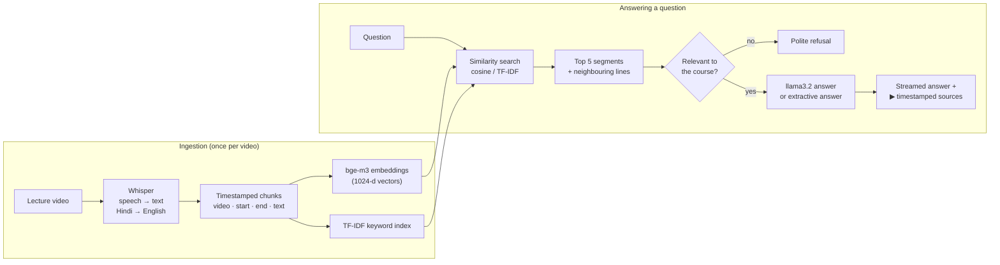

# 🎓 RAG-based AI Teaching Assistant

Ask a question about a video course and get **the exact lecture video and timestamp** that answers it, then play the video from that moment. Anyone can create an account, upload their own lecture videos, and the system transcribes and indexes them automatically.

**Live demo:** [ragbasedaiteachingassistant.streamlit.app](https://ragbasedaiteachingassistant-bjuax8qmlftfmx3bbmyumt.streamlit.app) · Built with Python, Whisper, bge-m3, scikit-learn, FastAPI and Streamlit

---

## Why

Course videos are long, and finding the one place a topic is explained means scrubbing through hours of footage. A general-purpose chatbot doesn't know your course and may invent answers. This project uses **Retrieval-Augmented Generation (RAG)**: it first *retrieves* the relevant parts of the lecture transcripts, then answers **only from them**, always with sources you can click.

## Features

- 💬 **Chat with a course.** Answers name the video and timestamp, with source cards for the 5 best-matching segments.
- ▶️ **Play from the cited moment.** Clicking a source opens the video at that second.
- ⬆️ **Upload your own lectures.** Video or audio is transcribed in the background with Whisper, with live progress (Queued → Transcribing 45% → Ready).
- 🌐 **Hindi / Hinglish support.** Optional translation of non-English speech to English during transcription.
- 🛡️ **No made-up answers.** Off-topic questions ("Who won the World Cup?") are politely declined.
- 🔐 **Accounts.** Each user only sees and manages their own courses.
- 📚 **Built-in demo course.** 18 lectures (7,252 transcript segments) of the Sigma Web Development course (HTML & CSS).

## How it works



1. **Transcribe:** Whisper turns each video's audio into short, timestamped segments (translating Hindi to English when needed).
2. **Index:** each segment is embedded with **bge-m3** (1024-dimensional vectors) and added to a **TF-IDF** keyword index.
3. **Retrieve:** the question is matched against every segment with cosine similarity (or TF-IDF when no embedding model is running). Each hit is widened with its ±3 neighbouring lines, and overlapping hits are merged.
4. **Guard:** a minimum similarity score plus an IDF-weighted word-coverage check reject questions the course doesn't cover.
5. **Answer:** the top 5 segments go into a prompt for **llama3.2** (via Ollama), whose answer streams token by token. Without an LLM, the answer is built directly from the best transcript passages.

## Tech stack

| Layer | Technology |
|---|---|
| Speech-to-text | OpenAI Whisper (original pipeline), **faster-whisper** (uploads, int8 on CPU) |
| Embeddings / LLM | **bge-m3** and **llama3.2** served locally by **Ollama** |
| Retrieval | NumPy cosine similarity, **scikit-learn** TF-IDF (unigrams + bigrams) |
| Backend | **FastAPI**, Uvicorn, Pydantic, background worker thread |
| Frontends | Custom HTML/CSS/JS web app, and a **Streamlit** app |
| Storage | SQLite (accounts), JSON + `.npy` files (courses, transcripts, vectors) |
| Security | PBKDF2-SHA256 password hashing, HttpOnly session cookies, login throttling |
| DevOps | Docker, Docker Compose, Nginx, Locust load tests, Terraform (AWS) |

## Project structure

```
├── streamlit_app.py        # Streamlit front end (the deployed version)
├── app/
│   ├── main.py             # FastAPI routes: chat (streaming), courses, uploads, auth, video playback
│   ├── model_loader.py     # Search index: embeddings, TF-IDF, context windows, segment merging
│   ├── llm.py              # Prompt building, relevance check, Ollama streaming, extractive answers
│   ├── courses.py          # Course storage + background Whisper transcription worker
│   ├── auth.py             # Accounts, password hashing, sessions, login throttling
│   ├── config.py           # Settings (models, paths, limits) via environment variables
│   └── static/             # Custom web UI (HTML/CSS/JS)
├── embeddings.joblib       # Pre-built index of the 18-lecture demo course
├── jsons/                  # Raw Whisper transcripts of the demo course
├── video_to_mp3.py         # Original offline pipeline, step 1: video → audio
├── mp3_to_json.py          #   step 2: audio → timestamped transcript (Whisper)
├── preprocess_json.py      #   step 3: transcript → embeddings (bge-m3)
├── process_incoming.py     #   step 4: question → retrieval → LLM answer (CLI)
├── Dockerfile, docker-compose.yml, nginx.conf, locustfile.py, terraform/
└── requirements.txt
```

## Run it locally

```bash
python3 -m venv .venv
.venv/bin/pip install -r requirements.txt
```

**Streamlit app:**
```bash
.venv/bin/streamlit run streamlit_app.py
```

**FastAPI web app** (custom UI at http://localhost:8000, API docs at http://localhost:8000/docs):
```bash
.venv/bin/uvicorn app.main:app --port 8000
```

Sign up, then try the demo course or create your own course and upload a video.

- **Without Ollama** everything works out of the box: retrieval uses keyword (TF-IDF) search and answers are built from the transcripts.
- **With Ollama** (`ollama pull bge-m3`, `ollama pull llama3.2`, then `ollama serve`), it switches to semantic search with the same bge-m3 model the index was built with, and llama3.2 writes the answers. Restart the app after starting Ollama.

With Docker: `docker compose up --build`, then open http://localhost:8080.

### Configuration

Set these as environment variables (defaults in `app/config.py`):

| Variable | Default | Purpose |
|---|---|---|
| `MODEL_BACKEND` | `auto` | `auto` (Ollama if reachable, else keyword), `ollama`, `keyword`, `mock` |
| `OLLAMA_URL` | `http://localhost:11434` | Ollama server |
| `OLLAMA_LLM_MODEL` | `llama3.2` | Model that writes answers |
| `WHISPER_MODEL` | `small` (`base` in Streamlit) | `tiny` / `base` / `small` / `medium` / `large-v3`: speed vs accuracy |
| `MAX_UPLOAD_MB` | `2048` | Upload limit for the FastAPI app (Streamlit: `maxUploadSize` in `.streamlit/config.toml`) |
| `DATA_DIR` | `data` | Where accounts, uploads and transcripts are stored |

## Uploads and accounts

- Uploaded files are stored under `data/courses/<course_id>/`: the media file, its transcript, and (with Ollama) its embeddings. Unfinished transcriptions resume automatically after a restart.
- Accounts live in SQLite at `data/app.db`. Passwords are hashed with **PBKDF2-SHA256 (600k iterations)**. Sessions are random tokens in **HttpOnly, SameSite=Lax** cookies (marked `Secure` over HTTPS), and only their SHA-256 hash is stored.
- Each course belongs to its creator. Other users get "not found" for it, so they can't even tell it exists.
- After 10 failed logins for an email or IP address, logins pause for 15 minutes. Cross-site write requests and anonymous uploads are rejected before the request body is read.

## Deploying on Streamlit Community Cloud

1. Push the repository to GitHub (`.gitignore` already excludes `.venv/` and `data/`).
2. On https://share.streamlit.io, click **Create app**, pick the repo, branch `main` and main file `streamlit_app.py`.
3. Under **Advanced settings**, choose Python 3.12, then **Deploy**.

Limits of the free tier:
- **Storage is temporary.** Accounts and uploads are wiped when the app restarts, redeploys or wakes from sleep. The demo course always remains because it ships with the repo.
- **Shared CPU.** Whisper `base` is used by default, so long videos take a while. For long lectures, uploading only the audio (MP3/M4A) is much smaller and transcribes the same.
- **No Ollama.** Answers are built from transcript passages using keyword search.
- **Logins last for the browser tab.** Refreshing the page logs you out.

## Engineering notes

A few problems solved along the way:

- **Compound words:** Whisper wrote "useEffect" as "use effect", so keyword search missed it. CamelCase terms are now split before indexing and searching.
- **False refusals:** "What *does* useEffect do?" was rejected because "does" never appears in a lecture. Question words are now ignored by the relevance check.
- **Off-topic matches:** "capital of France" matched a lesson about *capital letters*. An IDF-weighted coverage check now requires the question's important words to appear in the matched passage.
- **Production-only failure:** on Streamlit Cloud every upload failed with `open() got an unexpected keyword argument 'metadata_errors'`. Cloud installed PyAV 19, which removed an argument faster-whisper still passes. Pinning `av<19` fixed it.

## Limitations and next steps

- Permanent storage (Postgres for users and metadata, S3 for media) for the hosted version
- A vector database (FAISS / pgvector) once there are millions of segments
- A hosted LLM API for written answers where Ollama isn't available
- A task queue (Celery/Redis) with GPU workers for faster transcription
- An evaluation set of questions with known answers to measure retrieval quality (recall@5)
- Password reset by email and per-user storage limits
